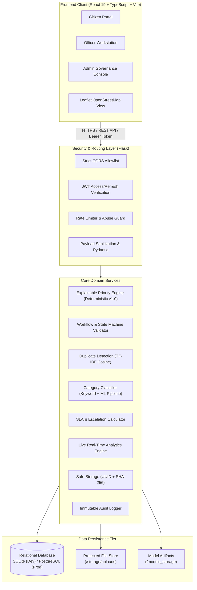

# CivicResolve AI — System Architecture Document

## 1. Architectural Overview

CivicResolve AI adopts a modern 3-Tier Layered Architecture with clear separation of concerns, decoupling client presentation, RESTful business logic, deterministic rule engines, and ACID-compliant relational persistence.

---

## 2. Layer Descriptions

### 2.1 Client Presentation Layer
- **Framework:** React 19 with Vite 6 build toolchain and TypeScript strict mode.
- **Styling & Layout:** Tailwind CSS v4, Lucide React icons, and accessible responsive components.
- **State Management:** TanStack React Query for declarative server-state management, cache invalidation, and automatic background re-fetching.
- **Geographic Visualization:** Leaflet with OpenStreetMap tiles, adhering to open attribution standards.
- **Internationalization:** Custom zero-dependency React context delivering instant toggle between English and Tamil (தமிழ்).

### 2.2 Security & Routing Layer
- **Framework:** Python Flask Application Factory pattern.
- **Authentication:** `flask-jwt-extended` generating short-lived access tokens (JWT) and long-lived refresh tokens.
- **Authorization:** Declarative Python decorators `@jwt_required()` and `@role_required(["admin", "officer"])`.
- **CORS:** Explicit origin allowlist (e.g. `http://localhost:5173`, `http://127.0.0.1:5173`) with strict header whitelisting.
- **Input Validation:** Pydantic schemas validating all incoming request bodies prior to business logic execution.

### 2.3 Core Domain Services Layer
- **Explainable Priority Engine (`app/services/priority_engine.py`):**
  - Evaluates explicit signals: safety emergencies (+30), essential service outage (+20), critical facility proximity (+15), prolonged outage duration (+10), repeated nearby grievances (+10), vulnerable individual impact (+5), and category baseline (+5 to +10).
  - Emits mathematical breakdown and human-readable text justification.
- **Duplicate Detection Service (`app/services/duplicate_detection.py`):**
  - Employs Scikit-Learn `TfidfVectorizer` and cosine similarity computation over grievances filed within a 30-day temporal window in the same category.
  - Suggests potential duplicates without auto-merging or leaking private data.
- **Category Classification Service (`app/services/classification_service.py`):**
  - Primary: Deterministic multilingual keyword taxonomy.
  - Secondary: Scikit-learn TF-IDF + Multinomial Logistic Regression pipeline saved via `joblib`.
- **SLA & Escalation Engine (`app/services/sla_service.py`):**
  - Evaluates elapsed hours against category baseline SLAs. Auto-flags `ESCALATED` if resolution is overdue and notifies departmental officers.
- **Safe Evidence Storage (`app/services/storage_service.py`):**
  - Validates file headers/magic bytes for JPEG/PNG/WebP.
  - Re-keys files to random UUIDv4 names and computes SHA-256 integrity checksums to prevent path traversal (`../`) and remote code execution (`.exe`, `.py`).

### 2.4 Persistence Layer
- **Relational Schema:** SQLAlchemy ORM with fully normalized third normal form (3NF) tables.
- **Engine Portability:** Supports local zero-configuration SQLite for rapid development and PostgreSQL with connection pooling for enterprise production.

---

## 3. High-Availability & Failure Modes

| Subsystem | Potential Failure | Architectural Mitigation |
| :--- | :--- | :--- |
| **ML Model** | Joblib file missing or corrupted | Falls back instantly to deterministic keyword-based category classifier. |
| **Priority Rules** | Database rules table empty | Hardcoded fallback rules in `PriorityEngine` guarantee un-interrupted scoring. |
| **Storage** | Disk quota reached or I/O failure | Transaction rollback prevents complaint creation without evidence integrity. |
| **Database** | Concurrency conflict on status | Row-level locking and transaction isolation guarantee status machine integrity. |
